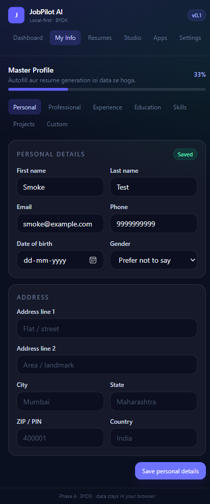
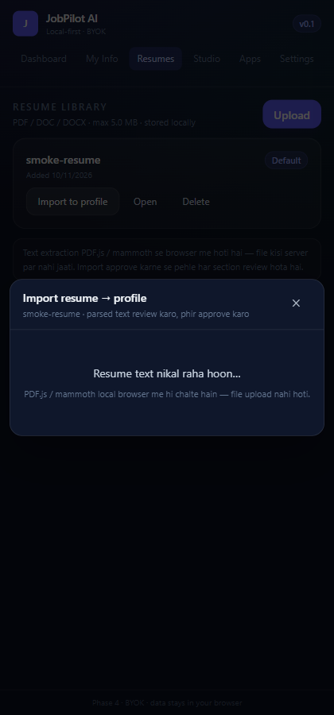
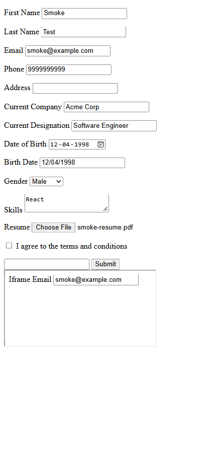
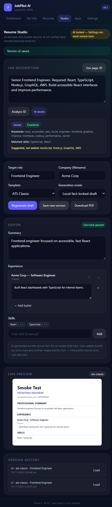
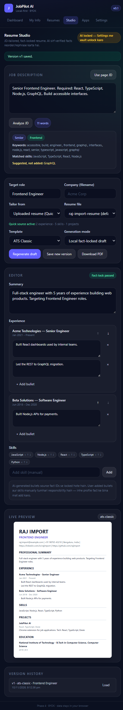
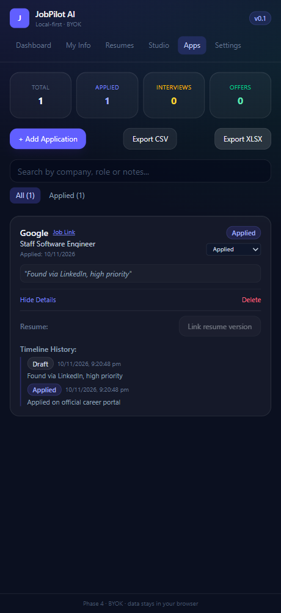

# JobPilot AI

AI-powered job application assistant — Chrome MV3 extension with local-first storage and an optional sync backend.

> One profile. Tailored resumes. Faster applications.

## Status

**Phases 1–3 complete and verified. Phase 4 is partial: the local tracker works, the cloud backend is only a skeleton.**

Last verified on 2026-11-10 — `npm run typecheck`, `npm run test` (autofill, resume, tracker) and `npm run smoke` (extension, autofill, studio, tracker) all pass.

### What works today

- MV3 extension builds and packs (`dist/` validated with CRX packs).
- Popup shell + side panel with Dashboard / My Info / Resumes / Studio / Apps / Settings tabs.
- **Master Profile (Phase 1):** personal details, address, professional summary, links, job preferences.
- **Repeatable sections:** experience, education, projects, skills — add / edit / delete.
- **Custom fields:** text, textarea, number, date, boolean, select, multiselect, URL, email, phone; sensitive flag.
- **Resume library:** upload PDF / DOC / DOCX (max 5 MB), open, set default, delete. Files live in IndexedDB.
- **Resume import (FR-RES-01…05):** PDF.js + mammoth text extraction, scanned-PDF detection, local heuristic parser, optional AI structured parse with Zod validation, and a diff/review screen (merge or replace) that only writes to the profile after approval.
- Profile completeness score + setup checklist on the dashboard.
- **Smart Autofill (Phase 2):** scans native inputs, selects, radio groups, textareas, contenteditable and same-origin iframes.
- Mapping preview with confidence tiers, manual override, sensitive-field review, remembered domain mappings and fill report.
- React/Vue-safe native setters + input/change/blur events, resume attach (best effort), dynamic-form rescan and one-session undo.
- **Duplicate Detection & Auto-Drafting:** warns if previously applied to domain/company; automatically tracks a DRAFT record on fill; one-click "Mark as Applied" on submission.
- **AI Resume Studio (Phase 3):**
  - Webpage Job Description (JD) extraction, keyword / skill / seniority / domain analysis.
  - Deterministic fact-lock engine: AI may only reorder/rephrase verified facts; invented numbers and known invented skills are rejected.
  - ATS Classic + Modern templates, editable summary / bullets / skills / order, live styled preview (HTML approximation of the final A4 PDF).
  - `pdf-lib` PDF generation + download with standard file naming.
  - Version history snapshots per resume series.
  - Full tailor from Master Profile and Quick tailor directly from an uploaded resume.
- **Application Tracker (Phase 4, local):**
  - Status pipeline: `DRAFT` → `APPLIED` → `SCREENING` → `INTERVIEW` → `OFFER` / `REJECTED` / `WITHDRAWN` / `NO_RESPONSE`.
  - Timeline event history with notes on every status transition.
  - Search + status filter, soft delete with confirmation, duplicate detection.
  - CSV + XLSX export of application history.
- **Backend skeleton (Phase 4, partial):**
  - Layered structure: **Routes ➔ Controller ➔ Service ➔ Repository ➔ Database**.
  - Express 5 + Mongoose models (`Application`, `Profile`, `ResumeVersion`, `User`).
  - REST endpoints at `/api/v1/applications` (CRUD, status updates, CSV export) + `/api/v1/health`.
  - **Auth/JWT:** email/password registration, bcrypt password hashing, 15-minute access tokens, rotating 30-day refresh tokens, logout/revocation, and protected application routes.
  - **Sync API:** authenticated `/api/v1/sync/push` and `/api/v1/sync/pull` for application records, with optimistic version conflict responses and delete tombstones.
  - Not yet present: extension login/sync client, profile/resume sync routes, conflict resolution UI, GridFS backup.
- **Automated Verification:**
  - Unit tests: `npm run test` (autofill, resume-studio, tracker).
  - Playwright E2E smoke tests: `npm run smoke` (extension persistence, scan/fill/undo, studio PDF generation, tracker lifecycle & export).

### Not built yet (known gaps)

- **Tailor modes (FR-RES-07):** Full and Quick tailor are implemented. Manual mode remains a future polish item.
- **Resume ↔ application link (FR-RES-16 / FR-TRK-07):** implemented from the application detail view; link/change a generated version and show the linked role/version.
- **XLSX export (FR-TRK-10):** implemented alongside CSV; includes linked resume version and target role when available.
- **Settings completeness (FR-SET-05…10):** connection test, autofill preferences, export-all/delete-all and privacy explainer are implemented. Cloud sync controls remain pending.
- **Cloud (D-02):** auth and the application sync API are implemented, but the extension sync client, conflict UI and file backup are still pending. The extension still works entirely offline against IndexedDB.
- **Follow-up reminders (FR-TRK-13)** and **portal adapters** (Greenhouse / Lever / LinkedIn / Naukri / Indeed) are still pending.
- PDF uses standard Helvetica (WinAnsi), so non-Latin scripts (e.g. Devanagari) are stripped.

Full product spec: [`docs/00-understanding.md`](docs/00-understanding.md)

## Structure

```
resume-handler/
├─ apps/
│  ├─ extension/          Chrome MV3 extension (React + Vite + Tailwind + Dexie)
│  └─ backend/            Node + Express + Mongoose (skeleton: applications only)
├─ packages/
│  └─ shared/             Shared TypeScript types + Zod schemas + constants
├─ scripts/
│  ├─ smoke-extension.mjs Playwright persistence smoke test (Edge)
│  ├─ smoke-autofill.mjs  Playwright scan/fill/undo smoke test (Edge)
│  ├─ smoke-studio.mjs    Playwright JD → fact-locked draft → PDF smoke test (Edge)
│  ├─ smoke-tracker.mjs   Playwright tracker CRUD/timeline/CSV smoke test (Edge)
│  └─ smoke-import.mjs    Playwright PDF → extract → review → import smoke test (Edge)
├─ tests/                 Node unit tests (autofill, resume studio, import, tracker)
├─ docs/
│  ├─ 00-understanding.md PRD / decision log
│  └─ screenshots/        Phase 1–4 UI captures
├─ package.json           npm workspaces
└─ tsconfig.base.json
```

## Prerequisites

- Node.js **22.12+** (tested on 24)
- npm 10+
- Google Chrome / Chromium 120+

## Install

```bash
npm install
npm run build:shared
```

## Extension

```bash
npm run dev:extension     # rebuild dist/ on change (load dist/ unpacked, click Reload)
npm run build:extension   # production build → apps/extension/dist
```

Load in Chrome / Edge:

1. Open `chrome://extensions` (or `edge://extensions`)
2. Enable **Developer mode**
3. **Load unpacked** → select `apps/extension/dist`
4. Pin the extension, open any job page, click the icon

> `npm run dev:extension` keeps rebuilding `dist/`. After a change, click **Reload** on the extension card.

### Screenshots













## Backend

```bash
cp apps/backend/.env.example apps/backend/.env   # fill MONGODB_URI
npm run dev:backend
```

Health check: `GET http://localhost:4000/api/v1/health`
Applications API: `http://localhost:4000/api/v1/applications` (Layered: Routes ➔ Controller ➔ Service ➔ Repository)

Auth API: `POST /api/v1/auth/register`, `POST /api/v1/auth/login`, `POST /api/v1/auth/refresh`, `POST /api/v1/auth/logout`
Sync API: `POST /api/v1/sync/push`, `GET /api/v1/sync/pull?since=<ISO date>`

> Application routes now require `Authorization: Bearer <accessToken>`. Sync, conflict resolution and GridFS file backup are not implemented, so the extension still works entirely offline against IndexedDB.

## Useful scripts

| Command | What it does |
|---|---|
| `npm run build` | Build shared + extension + backend |
| `npm run typecheck` | Typecheck every workspace |
| `npm run dev:extension` | Rebuild extension on change |
| `npm run dev:backend` | Backend dev server (tsx watch) |
| `npm run test` | Run all unit tests (autofill, resume-studio, import, tracker) |
| `npm run test:autofill` | Autofill matcher unit tests |
| `npm run test:resume` | Resume studio & fact-lock unit tests |
| `npm run test:import` | Resume parser, scanned-PDF detection & AI payload coercion tests |
| `npm run test:tracker` | Application tracker & URL normalizer unit tests |
| `npm run smoke` | Run all Playwright smoke tests (extension, autofill, studio, tracker, import) |
| `npm run smoke:extension` | Edge + Playwright persistence smoke test |
| `npm run smoke:autofill` | Edge + Playwright scan, fill, iframe, resume attach and undo test |
| `npm run smoke:studio` | Edge + Playwright JD analysis, fact-lock draft & PDF export test |
| `npm run smoke:tracker` | Edge + Playwright application CRUD, timeline & CSV export test |
| `npm run smoke:import` | Edge + Playwright PDF text extraction, review & profile import test |

## Architecture decisions

All locked decisions (D-01…D-10) and the data model live in the PRD:

- Local-first: IndexedDB (Dexie) is the primary store.
- Cloud: MongoDB Atlas M0 + Mongoose, sync deferred to Phase 4.
- AI: BYOK, encrypted in the browser, never sent to the backend.
- Resume: Master Profile immutable; AI only reorders/rephrases verified facts.
- Submission: always manual.

## License

Private / personal project.
